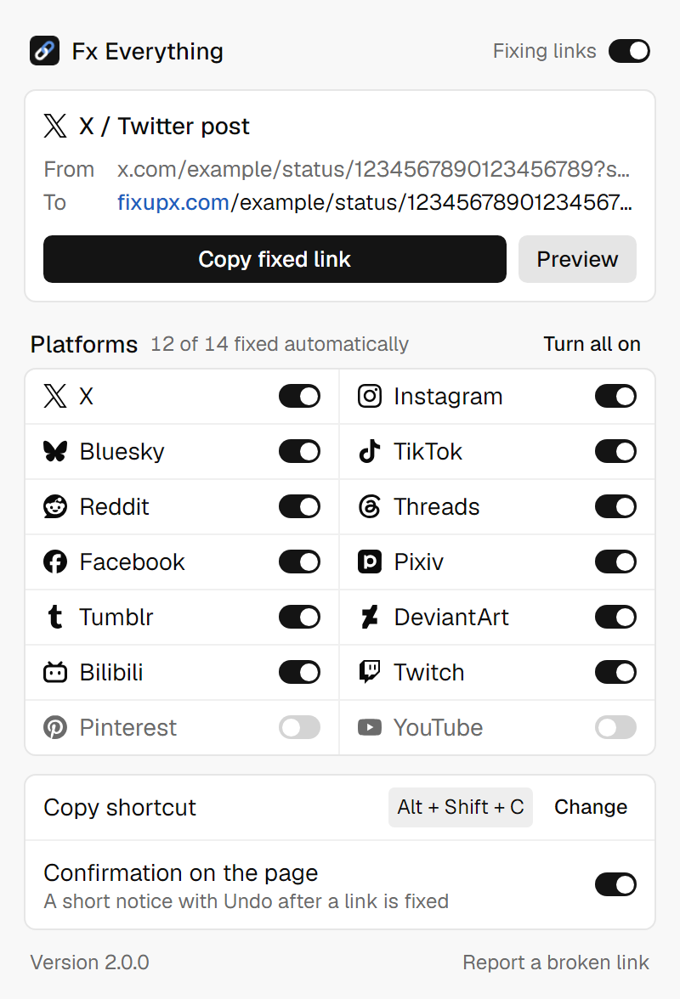

<div align="center">


# Fx Everything

**Copy a social post's link and get one that actually embeds in Discord, Telegram and the rest.**

<p>
  <a href="https://chromewebstore.google.com/detail/ogbkdfnmllglocipleheladghcjgjabk"></a>
  <a href="https://chromewebstore.google.com/detail/ogbkdfnmllglocipleheladghcjgjabk"></a>
  <a href="#supported-platforms"></a>
  <a href="#privacy"></a>
  <a href="#languages"></a>
  <a href="https://developer.chrome.com/docs/extensions/develop/migrate/what-is-mv3"></a>
  <a href="https://bun.sh"></a>
</p>

<p>
  <a href="https://chromewebstore.google.com/detail/ogbkdfnmllglocipleheladghcjgjabk"></a>
</p>

[Demo](#demo) · [How it works](#how-it-works) · [Platforms](#supported-platforms) · [Privacy](#privacy) · [Development](#development) · [FAQ](#faq)

</div>

```
x.com/juliobsz/status/20?s=46&t=Qx9…   →   fixupx.com/juliobsz/status/20
```

Paste a plain X, Instagram or TikTok link into a chat and you often get a bare URL or a blank
card. Fx Everything swaps the link for one served by an embed fixer (FixupX, fxbsky, vxreddit…),
which gives chat apps the image, video and text they need, and strips the tracking junk while
it's at it. You keep using the site's own **Copy link** button; nothing about browsing changes.

## Demo

<p align="center">
  <a href="https://youtu.be/C1xr8CyFl6Q"></a>
</p>

<p align="center">Click the thumbnail to watch the demo on YouTube</p>

## How it works

There are four ways to get a fixed link. All of them run locally in your browser.

| | Do this | You get |
|---|---|---|
| **Automatic** | Use the site's **Share → Copy link** | The fixed link lands in your clipboard, with a small notice and **Undo** in the top-right corner |
| **Shortcut** | Press <kbd>Alt</kbd>+<kbd>Shift</kbd>+<kbd>C</kbd> on an open post | The fixed link for the current tab. This is the address-bar equivalent; Chrome doesn't let extensions change what you copy from the address bar itself |
| **Right-click** | **Copy fixed link** on any post link, on any website | Fixes links you see in Discord web, Google results, other feeds… |
| **Popup** | Click the toolbar icon | A preview of the current tab's fixed link, with Copy and Preview buttons |

<p align="center">
  <picture>
    <source media="(prefers-color-scheme: dark)" srcset="assets/readme/popup-dark.png">
    
  </picture>
</p>

The popup also has a master on/off switch, a switch per platform, and a switch for the on-page
notice. Links that aren't a single public post (profiles, feeds, searches, anything malformed)
are always copied unchanged.

## Supported platforms

| | Platform | What gets fixed | Fixed with |
|---|---|---|---|
|  | X / Twitter | Posts, including `/i/status/` shares | [FixupX](https://github.com/FxEmbed/FxEmbed) |
|  | Instagram | Posts, Reels, carousels | [OGInstagram](https://oginstagram.com) |
|  | Bluesky | Posts, replies, quotes | [FxBluesky](https://github.com/FxEmbed/FxEmbed) |
|  | TikTok | Videos and photo posts | [fxTikTok](https://github.com/okdargy/fxtiktok) |
|  | Reddit | Posts, comments, `/s/` shares | [vxReddit](https://github.com/dylanpdx/vxReddit) |
|  | Threads | Posts | [vxThreads](https://vxthreads.com) |
|  | Facebook | Public posts, Reels, group posts, permalinks | [Facebed](https://facebed.com) |
|  | Pixiv | Artworks | [Phixiv](https://github.com/thelaao/phixiv) |
|  | Tumblr | Posts | [fxtumblr](https://www.tpmblr.com) |
|  | DeviantArt | Artworks, `sta.sh` shares | [fixDeviantArt](https://fixdeviantart.com) · [FixEmbed](https://fixembed.app) |
|  | Bilibili | Videos, `b23.tv` shares | [vxBilibili](https://vxbilibili.com) · [FixEmbed](https://fixembed.app) |
|  | Twitch | Clips | [FixEmbed](https://fixembed.app) |
|  | Pinterest | Pins, `pin.it` shares | [FixEmbed](https://fixembed.app) |
|  | YouTube | Community posts | [FixEmbed](https://fixembed.app) |

Every service was checked against real posts on November 7, 2026, and the ones that return a
real preview image were picked over generic ones. These are independent projects run by other
people; if one goes down, [open an issue](https://github.com/juliobsz/fxEverything/issues/new?template=bug_report.yml)
and it can be swapped in a release.

## Languages

The extension follows Chrome's language: **English** by default and **Português (Brasil)**
when Chrome is set to Portuguese. Translations live in `public/_locales/<locale>/messages.json`;
to add a language, copy `en/` to a new [Chrome locale code](https://developer.chrome.com/docs/extensions/reference/api/i18n#locales)
and translate the `message` values. `bun run test` checks that every locale has the same keys
and placeholders.

## Privacy

- **Nothing leaves your browser.** Links are recognised and rewritten locally. No analytics,
  accounts, backend or remote config, and the extension itself makes no network requests.
- **It never reads your clipboard.** It only changes what a supported site is already copying,
  or writes a link when you ask for one.
- **Narrow access.** It runs only on the 14 platforms' own domains. `activeTab`, `scripting`
  and `contextMenus` power the shortcut, the right-click menu and the notice; `storage` keeps
  your switches on your device.

When a fixed link is later opened or embedded, that app talks to the embed service under the
service's own terms. Full policy: [`PRIVACY.md`](PRIVACY.md).

## Development

Requires [Bun](https://bun.sh) and Chrome 111 or later.

```bash
bun install
bun run build        # typecheck + build into dist/ and release/fxeverything-x.y.z.zip
```

Then open `chrome://extensions`, turn on **Developer mode**, choose **Load unpacked** and pick
`dist/`.

| Command | What it does |
|---|---|
| `bun run dev` | Vite dev build with hot reload |
| `bun run test` | URL tests, a production build, and regression tests that run the built content script |
| `bun run typecheck` | TypeScript only |
| `bunx vite --config vite.preview.config.ts` | Popup in a normal tab with a mocked `chrome.*` (open `/preview.html?url=<tab url>`) |

<details>
<summary>Project layout</summary>

```
src/
├─ content/
│  ├─ main.iife.ts            # page world: wraps the clipboard, rewrites Copy link
│  └─ settings-bridge.iife.ts # isolated world: passes your switches to the page script
├─ background.ts              # shortcut, right-click menu, re-injection after updates
├─ popup/                     # React popup
└─ shared/
   ├─ platforms.ts            # every platform: domains, URL rules, embed service
   ├─ settings.ts
   ├─ i18n.ts                 # t("key") over public/_locales
   └─ toast.ts                # the on-page notice
docs/                         # product & technical specs, store listing, release checklist
```

Adding a platform is one entry in `PLATFORMS` plus one rewrite function in
`src/shared/platforms.ts`; the manifest's host list is generated from it.
</details>

## FAQ

<details>
<summary><b>Why can't it change links I copy from the address bar?</b></summary>

Chrome doesn't give extensions any access to the address bar's copy. Press
<kbd>Alt</kbd>+<kbd>Shift</kbd>+<kbd>C</kbd> instead; it copies the fixed link of the post in the
current tab. You can change the key at `chrome://extensions/shortcuts`.
</details>

<details>
<summary><b>A link wasn't fixed. What now?</b></summary>

Check the platform's switch in the popup, then make sure you copied a single post (not a
profile or feed). If it still fails, [report it](https://github.com/juliobsz/fxEverything/issues/new?template=bug_report.yml)
with the kind of link (not a private one).
</details>

<details>
<summary><b>The embed is broken but the link was rewritten.</b></summary>

That's the embed service or the post itself (private, age-restricted, deleted). Try the
**Preview** button in the popup to see what the service returns.
</details>

<details>
<summary><b>Firefox? Edge?</b></summary>

Edge, Brave and other Chromium browsers can install it from the Chrome Web Store.
Firefox isn't supported yet.
</details>

## Credits

The embed services above do the real work. Platform logos in the popup come from
[Simple Icons](https://simpleicons.org) (CC0) and remain trademarks of their owners. The popup
font is [Geist](https://vercel.com/font) (OFL).

Fx Everything isn't affiliated with any supported platform, with Discord, or with any embed
service.

<div align="center">

[MIT](LICENSE) · made by [juliobsz](https://github.com/juliobsz)

</div>
